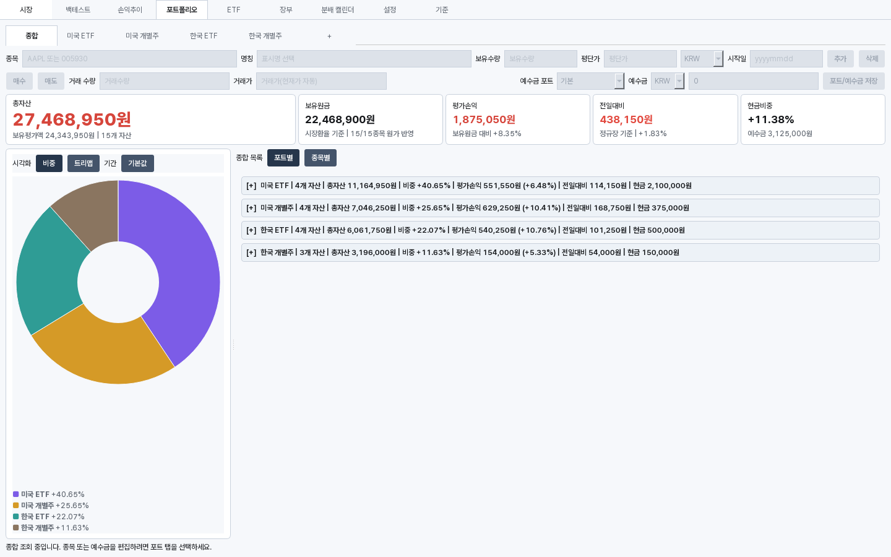

# Market Overlay

주요 시장 지표와 개인 포트폴리오 상태를 데스크톱 오버레이로 확인하는 Windows용 투자 보조 도구입니다. 증권사 로그인이나 자동 매매 없이 보유내역과 매매ㆍ배당 기록을 직접 관리합니다.

이미지는 가상 계좌와 시세로 만든 예시 화면입니다(v2.5에서 촬영, 일부 배치는 최신 버전과 다를 수 있습니다).

## 다운로드

- 최신 릴리즈: [Market Overlay Releases](https://github.com/Link-1214/market-overlay/releases)
- 현재 정식 버전: `v2.6.0`
- 설치 파일: [MarketOverlaySetup_v2.6.exe](https://github.com/Link-1214/market-overlay/releases/download/v2.6.0/MarketOverlaySetup_v2.6.exe)

설치 파일을 실행하면 기존 버전이 같은 경로에 업데이트 설치됩니다. 포트폴리오, 장부(매매ㆍ입출금ㆍ배당), 사용자 표시명, 설정은 `%APPDATA%\MarketOverlay`에 보관되어 업데이트 후에도 유지됩니다. 업데이트 전에 설정의 `데이터/백업`에서 백업을 내보내 두기를 권장합니다.

## 주요 기능

- 시장 오버레이: CNN F&G, VIX, USD/KRW, S&P 500, Nasdaq Composite, KOSPI 등 주요 지표와 미국 선물 확인
- 종합 오버레이: 시장 요약과 포트폴리오 핵심 수치를 한 화면에 압축 표시
- 내 포트폴리오 오버레이: 도넛 또는 트리맵 비중과 보유평가액, 전일대비, 평가손익, 평가수익률 확인
- 포트폴리오 관리: 포트별 보유종목과 원화ㆍ달러ㆍ엔화 예수금, 매수/매도, 직접 수정. 총자산ㆍ보유원금ㆍ평가손익ㆍ전일대비ㆍ현금비중 요약
- 손익추이: 매매ㆍ배당 기록으로 재현한 보유원금ㆍ평가액과 누적 총손익 변화
- 백테스트: 현재 보유구성을 과거에도 들고 있었다고 가정하고 주요 지수와 비교
- ETF 정보: 내장 한국ㆍ미국 ETF 6,462종의 투자 목표, 운용 방식, 비용, 상위 편입종목, 업종, 분배 이력
- 장부: 매매기록, 입출금, 배당을 한 탭에서 관리
- 분배 캘린더: 연도별로 받은 분배와 향후 예상을 월 카드로 확인
- 비중/트리맵: 현재 자산 비중과 선택 기간 수익률을 시각화
- 일별 기록과 백업: 시장 종가ㆍ포트폴리오 일별 요약 CSV 내보내기, 백업 내보내기와 복원

## v2.6 핵심 변경

- 앱 첫 화면과 ETF 목록의 검색ㆍ선택ㆍ탭 재진입이 빨라졌습니다.
- 겹치는 시세ㆍ환율ㆍ과거 가격 조회를 함께 쓰고, 보유 종목 과거 일봉은 최근 구간만 새로 받아 이어 붙입니다. 장 마감 후와 24시간마다 전체를 다시 확인합니다.
- 과거 일봉 자리에 주봉ㆍ월봉이 쓰이던 오류와 백테스트에서 환율을 받지 못하면 1원으로 계산하던 문제를 고쳤습니다.
- 일별 기록을 화면 뒤에서 저장하고, 저장에 실패하는 동안에도 백업ㆍCSV 내보내기를 할 수 있습니다.
- 좁은 창에서 포트폴리오 표는 가로 스크롤로 전체 금액을 보여 주고, 긴 ETF 투자목표ㆍ편입종목 이름과 백테스트 눈금 겹침을 고쳤습니다.
- 내장 ETF와 종목명을 2026년 9월 자료로 갱신했습니다.

## v2.5 핵심 변경

- 포트폴리오 요약을 총자산ㆍ보유원금ㆍ평가손익ㆍ전일대비ㆍ현금비중 5개 카드로 정리하고, 현재 보유분 평가손익에 실현손익ㆍ배당ㆍ입출금을 섞지 않게 했습니다.
- `손익추이` 탭을 추가했습니다.
- `성과비교`를 `백테스트`로 이름을 바꾸고 탭 진입 시 자동 계산합니다.
- `ETF` 탭을 추가하고 ETF별 분배 이력과 예상 분배율을 조회합니다.
- 매매기록ㆍ입출금ㆍ배당을 `장부`로 묶고 `분배 캘린더`를 추가했습니다.
- 종합ㆍ내 포트폴리오 오버레이를 보유평가액ㆍ전일대비ㆍ평가손익ㆍ평가수익률 4카드로 정리했습니다.

## v2.4 핵심 변경

- 시장 탭과 시장/종합 오버레이에 S&P 500ㆍNasdaq-100 선물 등락과 방향 해석을 추가했습니다.
- 미국 프리ㆍ애프터의 최신 단일 가격을 현재가와 평가액에 반영하고, 종목 행에 세션 배지를 표시합니다.
- 포트폴리오 전체 전일대비, 트리맵 `전일` 색상, 일별 확정 기록은 정규장 가격만 사용합니다.
- 시장 종가와 포트폴리오 일별 요약을 저장하고 Excel에서 읽을 수 있는 CSV로 내보낼 수 있습니다.

## 문서

- [사용자 가이드](USER_GUIDE_V2_6.txt)
- [이미지로 보는 사용자 가이드](docs/USER_GUIDE_SCREENSHOT_V2_6.md)
- [v2.6 패치노트](PATCH_NOTES_V2_6.txt)
- [v2.6 릴리즈 노트](RELEASE_NOTES_V2_6.md)
- [변경 이력](CHANGELOG.md)

이미지 가이드는 v2.5에서 가상 데이터로 촬영한 화면을 재사용합니다. v2.6의 좁은 창 표시와 일부 메뉴ㆍ데이터 건수는 이미지와 다를 수 있으니 최신 설명은 사용자 가이드를 기준으로 보세요.

## 데이터와 주의

- 이 앱은 투자 판단을 대신하지 않는 보조 도구입니다.
- Yahoo Finance 기반 조회값은 증권사 HTS/MTS와 지연, 환율, 세금, 수수료 기준이 다를 수 있습니다.
- 총자산은 보유평가액 + 예수금, 평가손익은 보유평가액 - 현재 보유분 취득원가입니다. 외화 취득원가는 매수일 시장환율, 현재 평가액은 현재 환율을 쓰며, 전일대비는 정규장 기준입니다. 매매 수수료ㆍ세금 차감 전이고 배당은 세전 기준입니다.
- 내장 ETF(한국 1,175종ㆍ미국 5,287종)와 종목명 22,337종은 2026년 9월 갱신 자료입니다. 공시 기준일은 운용사마다 다르고, 미국 ETF는 편입 기준일이 제공되지 않아 수집일을 표시합니다. BNK자산운용 ETF 7종은 2026-08-10 자료를 유지합니다.
- 예상 분배는 과거 지급 이력으로 추정한 참고값이며 실제 지급을 보장하지 않습니다.
- CNN Fear & Greed 조회 실패 시 Local F&G 대체 계산값을 표시할 수 있습니다.
- 코드 서명이 없는 개인 빌드라 Windows SmartScreen 또는 보안 프로그램 경고가 표시될 수 있습니다. 내려받은 파일은 릴리즈의 `SHA256SUMS.txt`와 SHA-256을 비교해 확인할 수 있습니다.
- 앱은 업데이트를 자동 다운로드하거나 자동 설치하지 않습니다. 새 버전이 있으면 GitHub Release 페이지로 이동합니다.
- 문제 제보는 [Issues](https://github.com/Link-1214/market-overlay/issues)를 이용하되 계좌번호ㆍ개인 잔고ㆍ백업 파일은 올리지 마세요.

## 소스 코드

이 public repo는 일반 사용자 배포용입니다. 설치 파일, 사용자 가이드, 패치노트, 릴리즈 노트만 공개합니다.

개발 소스는 private repo에서 별도로 관리합니다. 코드 검토나 수정 협업이 필요하면 별도 권한을 받아 private repo를 사용하면 됩니다.
